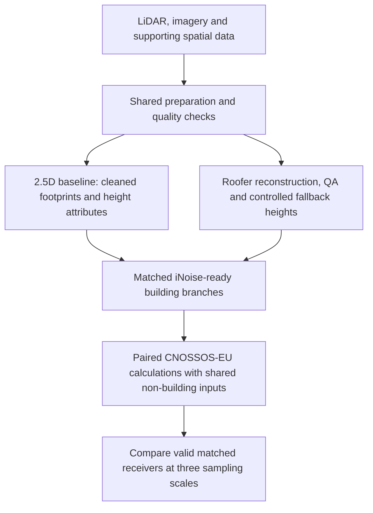

# MSc thesis: building representation in strategic noise mapping

**A controlled geospatial modelling comparison in central Graz, Austria.**

Henry Briscoe · University of Salzburg · UNIGIS MSc (CE), 2026

[Read the thesis in the University of Salzburg repository](https://eplus.uni-salzburg.at/urn/urn:nbn:at:at-ubs:1-67963)

## In brief

Does a richer building reconstruction materially change a strategic noise map once
it passes through an operational modelling workflow?

I compared a well-prepared 2.5D baseline with a LiDAR/Roofer-derived building
representation in iNoise using CNOSSOS-EU. The final branches used matched
footprints and building completeness, with building-height representation as the
main remaining difference. Terrain, ground conditions, sources, receivers and
calculation settings were held consistent between each pair.

The thesis reports modest broad-area differences and a small number of larger,
localised differences. It does **not** establish that either branch predicts
real-world noise more accurately: independent measured receiver data were unavailable.

This repository is a research case study. It contains explanatory documentation,
not the source datasets, acoustic models or an executable reproduction.

## My contribution

- Prepared and quality-checked point clouds, terrain and surface rasters,
  building footprints, transport-source data and receiver layouts.
- Built a 2.5D baseline using cleaned footprints and nDSM-derived heights where
  available. An nDSM represents height above terrain: DSM minus DTM.
- Used Roofer to reconstruct upstream CityJSON buildings and assessed which
  information could be retained in the final iNoise-ready layer.
- Applied reconstruction checks and fallback heights, and corrected missing
  building/context obstacles consistently in both branches.
- Prepared six acoustic calculation models: two building branches for each of
  three shared receiver sets.
- Compared valid receiver pairs and documented both the spatial differences and
  the information simplified or lost during conversion.

## The comparison

The final inputs contained **4,713 building/context obstacles in each branch**.
Both branches used the same footprint coverage. Accepted Roofer-derived heights
were retained in the enhanced branch; controlled fallback heights were used
where reconstruction or coverage was insufficient.

The detailed CityJSON, BuildingPart and roof-plane geometry remained upstream
reconstruction and QA evidence. It was **not imported as raw architectural
geometry for the final acoustic calculation**. This distinction defines what
the experiment can establish.

*Original summary diagram of the documented method; not a software execution graph.*

## Selected results

**ΔLden = enhanced-branch Lden − baseline Lden.** Lden is the day-evening-night
noise indicator. Positive differences mean a higher prediction in the enhanced
branch; negative differences mean a lower prediction. Neither sign indicates
greater accuracy.

| Receiver set | Valid pairs | Mean ΔLden (dB) | Observed range (dB) | Pairs with absolute difference ≥ 3 dB |
| --- | ---: | ---: | ---: | ---: |
| 10 m grid across the area of interest | 898 | −0.69 | −3.20 to +1.60 | 1 |
| 1 m grids in selected case-study areas | 9,005 | +0.08 | −2.40 to +5.20 | 9 |
| Façade-adjacent receivers | 150 | +0.29 | −0.20 to +3.20 | 1 |

Source: thesis Tables 4.1–4.2, pp. 73–74. These are reported thesis results,
not statistics recalculated for this repository. Counts refer to valid paired
outputs, not all receiver locations initially generated. Missing outputs were
excluded rather than treated as zero.

All nine 1 m-grid differences reaching the 3 dB threshold occurred in one selected
case area. The local results should not be generalised to every courtyard,
street canyon or urban setting. The three receiver sets cover different sampling
extents; their means are not a controlled experiment on grid resolution alone.

## What I learned

**The baseline matters.** Both branches benefited from high-resolution data.
The comparison tested the extra reconstruction workflow against a well-prepared
baseline, not high-quality data against deliberately weak inputs.

**Information can be lost between tools.** Rich upstream geometry does not
guarantee equally rich inputs to a downstream model. The thesis examines both
what survived conversion and whether it changed predicted outputs.

**Internal comparison is different from validation.** Matched inputs support
interpretation of model differences. Official modelled noise outputs offered
context and plausibility checks, not independent measurement-based validation.

Within this study's scope, the results support investigating enhanced preparation
selectively for local questions. They do not establish a universal replacement
for a well-prepared 2.5D workflow or a demonstrated reduction in prediction error.

## Tools and methods

| Area | Tools and work |
| --- | --- |
| GIS and spatial QA | ArcGIS Pro; CRS management; raster/vector processing; geometry, completeness and attribute checks |
| Point clouds and reconstruction | CloudCompare; classified LAS; Roofer; CityJSON |
| Visual inspection | CityJSON Ninja and Blender for upstream QA |
| Acoustic modelling | iNoise 2026 with CNOSSOS-EU |
| Comparison | Matched receiver identifiers; paired output checks; spatial interpretation at three sampling scales |

[Read the method, QA and limitations](docs/method-and-limitations.md).

## Thesis reference and publication scope

Briscoe, H. (2026). *Integrating Enhanced Building Representations into the
CNOSSOS-EU Method for Strategic Noise Mapping: Case Study: Graz, Austria.*
Master's thesis, University of Salzburg, Geographical Information Science &
Systems – UNIGIS MSc (CE). Submitted July 2026.

The summary and page references above were checked against the author's supplied
thesis PDF. The [institutional record](https://eplus.uni-salzburg.at/urn/urn:nbn:at:at-ubs:1-67963)
provides the full thesis and bibliographic details.

The thesis, third-party datasets, software, maps and screenshots are not
redistributed here. Their availability or use in the research does not establish
permission for redistribution. This documentation does not imply endorsement by
the software or data providers.
